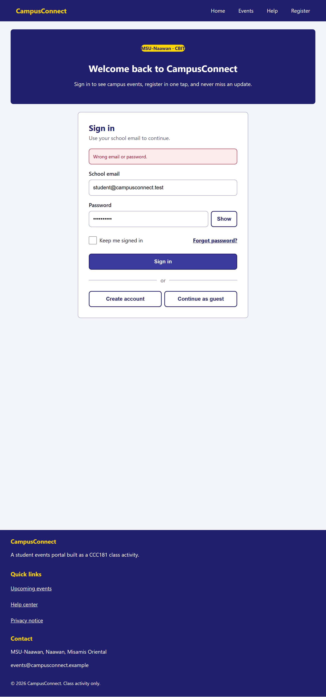
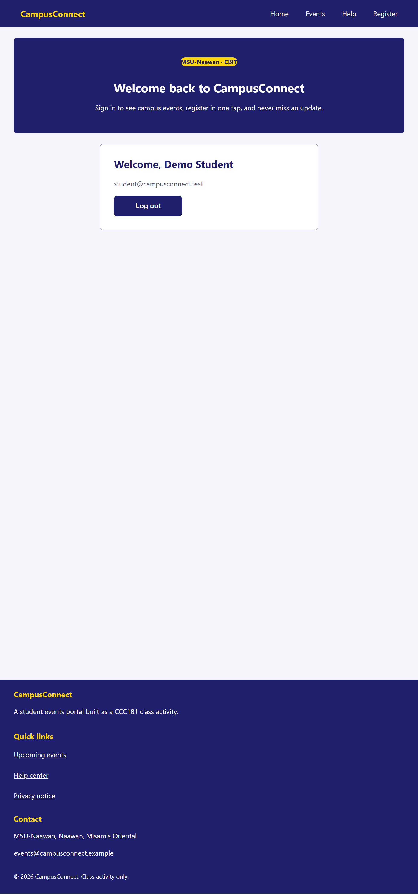

# CCC181 Week 10: CampusConnect Mobile-First Login Page

React + TypeScript starter for the Week 10 group activity. The page is already
built. Your group's job is the **mobile-first CSS** and the **GitHub teamwork**.

## Run it

```bash
npm install
npm run dev          # open the local URL it prints
npm run dev:phone    # same, but your phone (same Wi-Fi) can open the Network URL
npm run build        # must finish with no errors before you submit
```

## Rules

- Edit only the CSS files in `src/styles/` (one member = one file). Do not edit `reset.css`.
- Plain CSS only. No Tailwind, Bootstrap, Material UI, styled-components, or any UI library.
- Phone styles first (no media query), then `min-width` queries only. Never `max-width`.
- Do not edit the `.tsx` files or rename classes. If you must, tell the group first.

## Group information (fill in)

| Item           | Your answer |
| -------------- | ----------- |
| Group number   |             |
| Section        |             |
| Repository URL |             |

## Members (each member fills in their own row in their own commit)

| Member     | Name             | GitHub username | CSS file   | What I did                                                                                                                                                                                                                                                          |
| ---------- | ---------------- | --------------- | ---------- | ------------------------------------------------------------------------------------------------------------------------------------------------------------------------------------------------------------------------------------------------------------------- |
| 1 (leader) |                  |                 | `base.css` |                                                                                                                                                                                                                                                                     |
| 2          | Anrica Tinoy     | anricatinoy     | `nav.css`  | Part 2: Wrote docs/API-SPEC.md (3 required endpoints and the events design). Built the token middleware (requireAuth), GET /api/v1/users/me, and the 404 and 500 handlers. Made the Postman collection (7 requests), exported it, and took the Postman screenshots. |
| 3          | Zemeco M. Buntag | zemecobuntag    | `form.css` | Designed the login form in different screen sizes.                                                                                                                                                                                                                  |

## Experiment 0: the page without the viewport tag

What did the page look like in DevTools phone mode **before** adding the viewport meta tag?
What changed **after** adding it?

> (write your answer here)

## DevTools test results

| Width   | What must be true                                                                                                  | Pass? |
| ------- | ------------------------------------------------------------------------------------------------------------------ | ----- |
| 360 px  | 1 column. Nav links stacked and 48px tall. Options and buttons stacked. Footer in 1 column. No sideways scrollbar. | Pass  |
| 768 px  | Nav in one row (brand left, links right). Checkbox and link in one row. Two buttons side by side.                  | Pass  |
| 1024 px | Brand panel and login card side by side. Footer in 3 columns. Heading is larger.                                   | Pass  |
| 1280 px | Content centered and stops at 1200px.                                                                              | Pass  |

### Breakpoints I observed

Using **Show media queries** and dragging slowly from 360 px to 1280 px, the layout changed at these exact widths:

> (write the widths here, and say whether any width looked broken)

Screenshots are in `screenshots/` as `360.png`, `768.png`, `1024.png`, `1280.png`.

## What our group learned (leader writes this last)

> (write your answer here)

## Part 2 – Front end connected to the API (Member 3: Zemeco Buntag)

### How to run

1. Backend: `cd server`, copy `.env.example` to `.env`, `npm install`, `npm start` (runs on http://localhost:3000).
2. Front end: in the project root, copy `.env.example` to `.env`, `npm install`, `npm run dev` (runs on http://localhost:5173).
3. Demo login: student@campusconnect.test / Campus26

### What the front end uses

- `POST /api/v1/sessions`: log in, returns a token and the user.
- `GET /api/v1/users/me`: gets the logged-in user (sends the token), used for the Welcome screen and after a refresh.
- The API address comes from `VITE_API_URL` in `.env`.
- The token is kept in sessionStorage and removed on log out.

### What I did

- `src/api/auth.ts`: the API calls, error handling, and console logs of requests, responses and errors (password and token are hidden).
- `src/components/LoginForm.tsx` and `Welcome.tsx`: the form checks first, then calls the API; shows Loading, Success and Error states.
- `src/styles/auth.css`: styles for the error message and Welcome screen (mobile-first).

### Screenshots (360 px)



